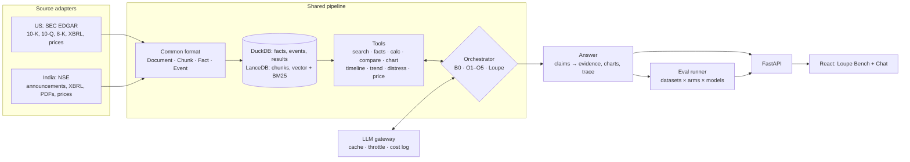
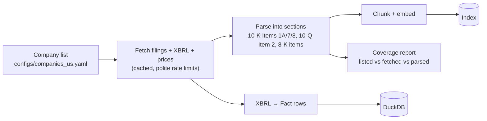
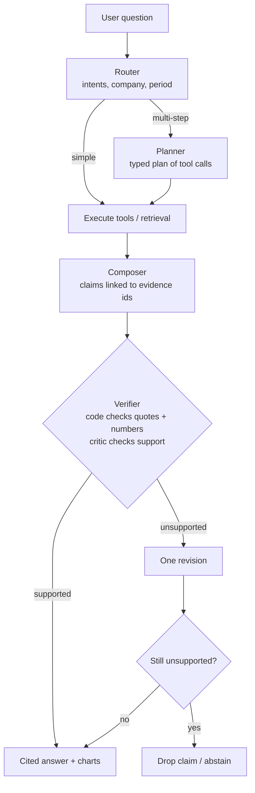
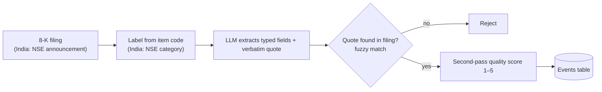
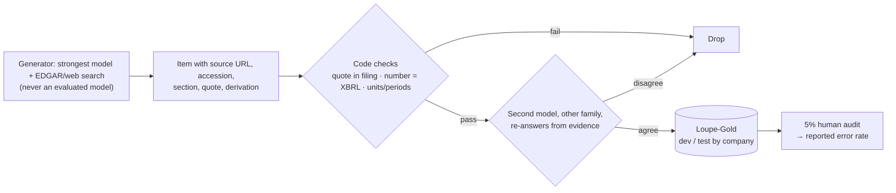
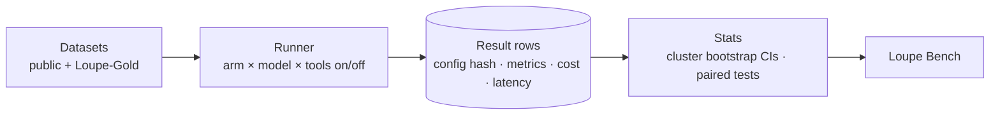
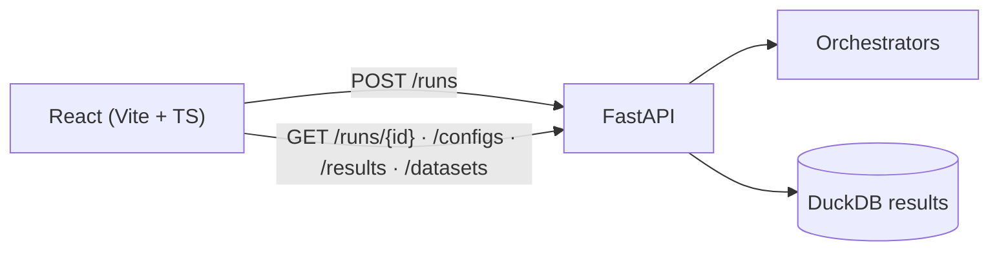

# Loupe

**A cited financial-risk copilot, and a benchmark that tests whether its agent orchestration actually helps.**

Loupe reads company filings, extracts risk events with verbatim evidence, and answers analysts' questions in chat with text, charts, comparisons and forecasts. Every claim links to the filing it came from. Every number is computed by code, never by the language model.

> SPPU BE Project (AI & DS) · *Agent-Orchestrated Financial Risk Extraction and Conversational Intelligence*
> Team: Shreyash Daware · Ayush Jha · Ojas Panse · Atharva Patil · Guide: Mrs. Kalpna Saharan

**Status:** P0 (setup and pre-registration) in progress. See the [Roadmap](#roadmap).

---

## Contents

1. [The problem](#the-problem)
2. [What Loupe does](#what-loupe-does)
3. [Research questions](#research-questions)
4. [System architecture](#system-architecture)
5. [Workflows](#workflows)
6. [Website: Loupe Bench](#website-loupe-bench)
7. [Datasets](#datasets)
8. [Roadmap](#roadmap)
9. [Repository layout](#repository-layout)
10. [Getting started](#getting-started)
11. [How we work](#how-we-work)
12. [Documents](#documents)

---

## The problem

- **Disclosures are long and scattered.** Analysts spend a large share of their time finding and checking facts across 10-Ks, 10-Qs, 8-Ks, earnings releases and, in India, exchange announcements, XBRL feeds and scanned PDFs.
- **Plain LLMs make things up.** General chat models answer company-specific questions fluently but invent numbers, periods and events. In finance that is a liability.
- **Existing tools stop short.** Terminals and research platforms (Bloomberg, AlphaSense, FactSet, Hebbia) are expensive and US-centric. Indian screeners (Trendlyne, Screener.in) are numbers-only, with no evidence-cited narrative and no chat.

## What Loupe does

| Capability | What the user gets |
|---|---|
| **Cited Q&A** | Ask anything about a company; each claim links to the filing, section and quote |
| **Risk-event extraction** | Auditor changes, restatements, debt defaults, executive exits and more, each with a verbatim quote and a quality score |
| **Exact numbers** | Values, growth and ratios computed by code from XBRL, never generated by the LLM |
| **Comparisons** | Several companies on one metric or topic, side by side |
| **Charts** | Generated from verified data only |
| **Predictions** | Metric trend projections with uncertainty, a distress score, and a price-forecast experiment tested against naive baselines. Never buy/sell advice |
| **Abstains when unsure** | Says what evidence is missing instead of guessing |

Phase 1 covers **25 US companies** (SEC EDGAR, FY2023–25). Phase 2 swaps in **10–20 Indian companies** (NSE disclosures). Only the data adapters change.

## Research questions

The project title promises *agent orchestration*, so the core question is whether our orchestration beats both plain LLMs and published orchestration methods.

| # | Question |
|---|---|
| RQ1 | How badly do plain LLMs answer company-specific financial questions? |
| RQ2 | Does Loupe's orchestration beat published ones at the same model, retrieval, tools and token budget? |
| RQ3 | Which component of our orchestration matters most? |
| RQ4 | Which retrieval and data stages matter? |
| RQ5 | Do results hold across models (small local vs 70B-class vs Gemini)? |
| RQ6 | How accurate is event extraction, and is its quality score calibrated? |
| RQ7 | Do forecasts beat naive baselines? |
| RQ8 | Does the pipeline transfer to Indian disclosures? |

The design and hypotheses are pre-registered in [`docs/hypotheses.md`](docs/hypotheses.md) before any experiment runs.

## System architecture



**Stack:**
- **Data:** Python 3.12 (uv), edgartools, DuckDB
- **Retrieval:** LanceDB with bge-small embeddings
- **Agents:** LiteLLM gateway, LangGraph orchestrators
- **Predictions:** statsmodels; charts as Plotly specs
- **Web:** FastAPI backend, React + Vite + TypeScript frontend
- **India (later):** PyMuPDF, Docling, OCR

**LLMs:** free tiers for now (Gemini, OpenRouter, Groq, NVIDIA NIM, local Ollama), listed in [`configs/models.yaml`](configs/models.yaml).

## Workflows

### 1. Data ingestion



For India, the same steps add these:
- an ISIN identity table
- PDF triage (text layer / tables / OCR)
- lakh/crore normalisation
- deduplication of NSE/BSE copies

### 2. Answering a question (Loupe-Orch v1)



### 3. Orchestrations we compare

Every arm uses the same model, retriever, tools and token budget, so only the orchestration differs.

| Arm | Method | Reference |
|---|---|---|
| B0 | Model alone, no retrieval | Baseline: shows hallucination |
| O1 | Single-shot RAG | Standard RAG |
| O2 | ReAct (think → act → observe) | Yao et al., ICLR 2023 |
| O3 | Plan-and-Execute / ReWOO | Wang et al., ACL 2023; Xu et al. 2023 |
| O4 | Router → one specialist agent | FARE, IEEE Access 2026 (base paper) |
| O5 | ReAct + Self-Refine critic | Madaan et al., NeurIPS 2023 |
| **Loupe** | Router + selective planner + tools + verifier + abstain | This project |

Each arm is also run with tools on (numbers from code) and tools off (the LLM does the arithmetic).

### 4. Risk-event extraction



### 5. Golden-dataset creation

AI builds the data; code and people check it.



### 6. Evaluation



Main metrics:
- numeric accuracy
- hallucination rate
- trick-question accuracy
- citation precision
- retrieval recall@k
- routing/plan accuracy
- event-extraction F1
- cost and latency

Test companies are used only in final runs, and every run is logged in [`docs/research-log.md`](docs/research-log.md).

## Website: Loupe Bench

A React app over the FastAPI backend, for the team during research and for the guide and examiners at reviews.

| Page | What it shows |
|---|---|
| **Compare** | Pick a question (from any dataset, or type one) and up to 4 configs (model × orchestration × retrieval). See the answers side by side, with clickable citations, a step-by-step tool trace, tokens, cost and latency, and the gold answer with a correctness badge. Runs live, or loads cached results. |
| **Leaderboard** | Scores with 95% confidence intervals, filterable by dataset, stage, model, arm and tools on/off |
| **Stage view** | A waterfall from B0 to Loupe showing what each stage adds, ablation tables and per-stage metrics |
| **Dataset explorer** | Every gold item with its source, quote, verification status and audit result |
| **Chat** | The product: cited answers, charts, comparisons, forecasts, event timelines |



## Datasets

**Public benchmarks** (verified Oct 2026; licences noted in each dataset card):

| Dataset | Tests |
|---|---|
| FinanceBench (150 open) | Retrieval + QA on real 10-K/10-Q/8-K, page-level evidence |
| FinDER | Retrieval against gold passages |
| DocFinQA | Numeric QA over full-length filings |
| ConvFinQA | Multi-turn numeric chat |
| FinQA / TAT-QA | Numeric reasoning, code-as-action |
| Finance Agent Benchmark (public split) | Agent tool use on EDGAR |
| FailSafeQA | Hallucination and refusal under bad or missing context |
| SECQUE | Analyst-style comparison, ratio and risk questions |
| IndFin-Bench, IndiaFinBench | Indian pilots |

**Loupe-Gold** is our own set, on our companies (FY2023–25). It covers what the public sets don't:
- exact numeric and calculation questions from XBRL
- verified 8-K events
- comparisons
- chart data
- trick questions (false premises, invented events)
- expected tool plans
- multi-turn conversations
- forecast backtests

## Roadmap

| Phase | Goal | Done when | Status |
|---|---|---|---|
| **P0** | Setup and pre-registration | Models checked, company list frozen, hypotheses tagged `prereg-v1` | 🟡 in progress |
| **P1** | US data layer | ≥95% filing coverage; cited search works for every company | ⬜ |
| **P2** | Thin end-to-end + Bench skeleton | One question runs on B0 vs Loupe across 2 models in the Compare page | ⬜ |
| **P3** | All arms, full toolset, event extraction | Every arm answers the same 10 questions; tools pass unit tests | ⬜ |
| **P4** | Datasets | Public loaders + verified Loupe-Gold + audit error rate | ⬜ |
| **P5** | Experiments | Every hypothesis has a result with CIs in the Bench | ⬜ |
| **P6** | India swap | The same matrix runs on Indian data | ⬜ |
| — | Significance write-up | Problem, users, competitors, impact, backed by our numbers | ongoing |

Full detail: [`docs/PLAN.md`](docs/PLAN.md).

**Workstreams:**

| Stream | Owns |
|---|---|
| A · Data | sources, ingest, index, coverage; India adapters |
| B · Orchestration & tools | gateway, all arms, Loupe-Orch, tools, event extraction, predictions |
| C · Evaluation | dataset loaders, Loupe-Gold pipeline, runner, metrics, stats, audit |
| D · Bench & story | FastAPI, React Bench + Chat, charts, significance docs, demo |

## Repository layout

```
Loupe/
├── src/loupe/
│   ├── core/           # ✅ data contracts (schemas) and settings
│   ├── llm/            # ✅ gateway: cache, throttle, retry, cost log; model probe
│   ├── cli.py          # ✅ `loupe` command
│   ├── sources/us/     # P1  EDGAR filings, XBRL facts, prices   (sources/india/ in P6)
│   ├── ingest/ index/  # P1  sections, chunks, embeddings, hybrid search
│   ├── tools/          # P2–P3  search, facts, calc, compare, chart, timeline, trend, distress, price
│   ├── extract/        # P3  8-K event extraction, quote validator, quality scorer
│   ├── orchestrators/  # P2–P3  b0, rag, react, plan_execute, router, self_refine, loupe
│   ├── datasets/       # P4  public loaders, Loupe-Gold builders and verifiers
│   ├── eval/           # P4–P5  runner, metrics, judge, statistics
│   └── api/            # P2  FastAPI
├── web/                # P2  React + Vite + TypeScript (Bench + Chat)
├── configs/            # models.yaml, companies_us.yaml, arms/
├── data/               # raw/ processed/ cache/ (git-ignored) · gold/ (versioned) · taxonomy/
├── docs/               # PLAN, hypotheses, decisions, research-log, significance/, papers/
└── tests/
```

## Getting started

Needs [uv](https://docs.astral.sh/uv/). It installs Python 3.12 if missing.

```bash
uv sync                    # create .venv and install
cp .env.example .env       # add SEC contact + free-tier API keys (never commit .env)
uv run loupe models list   # registered models and which keys are set
uv run loupe models check  # probe each model: reachable, tool calling, JSON mode
uv run pytest              # run tests
```

Optional, for local models: install [Ollama](https://ollama.com) and run `ollama pull qwen2.5:7b-instruct`.

## How we work

- **Branches:** work on a feature branch and open a PR into `initialize`; `initialize` is merged into `main` at milestones.
- **Before pushing:** `uv run ruff check . && uv run ruff format . && uv run pytest` (also run by `pre-commit install`).
- **Every LLM call goes through `loupe.llm.Gateway`.** It is cached, so reruns are free and results are reproducible.
- **Every decision** that affects scope or results gets a row in [`docs/decisions.md`](docs/decisions.md).
- **Every experiment run** gets an entry in [`docs/research-log.md`](docs/research-log.md).
- **Never tune on test companies**, and never edit `docs/hypotheses.md` after the `prereg-v1` tag.
- **Keys stay in `.env`.** Raw data stays out of git.

## Documents

| Doc | Purpose |
|---|---|
| [`docs/PLAN.md`](docs/PLAN.md) | Full research and build plan |
| [`docs/hypotheses.md`](docs/hypotheses.md) | Pre-registered design, metrics and decision rules |
| [`docs/decisions.md`](docs/decisions.md) | Decisions log |
| [`docs/research-log.md`](docs/research-log.md) | Experiment runs |
| [`docs/significance/`](docs/significance/) | Problem, users, competitors, impact |
| [`docs/papers/`](docs/papers/) | Base paper (FARE) and paper map |
